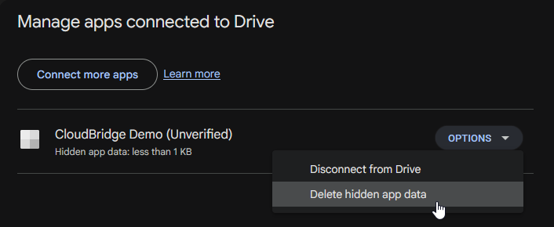
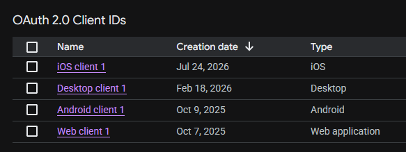

# ☁️ Google Drive

Start by instantiating the service:

```kotlin
val service = CloudBridge.googleDrive(clientId = "yourClientId")
```

On desktop, also pass the client secret. This is provided in the Google Drive API console when you
create a desktop client.

```kotlin
CloudBridge.googleDrive(
    clientId = "yourClientId",
    desktopClientSecret = "yourSecret"
)
```

On Android, the client ID isn't used (Google Identity Services identifies the app by its package
name and signing certificate), so any value works.

Then, authenticate using the platform-specific methods below. Once authenticated,
the [shared API](../api/Overview.md) is available.

## Compatibility

=== "App Data folder visibility"

    The App Data folder is not shown to users. A user can only see the amount of space it takes up
    by going to [drive.google.com](https://drive.google.com/drive) and navigating to _Settings_ » _Manage apps_.

    

=== "Duplication"

    Files and folders don't need unique names in Google Drive. To avoid confusing duplicates,
    CloudBridge does its best to prevent them: `createFile()`, `createFolder()`, `moveFile()`
    and `moveFolder()` first check the target folder and throw a `ConflictException` if
    a file/folder with the new name already exists.

=== "File types"

    Folders in Google Drive are just files, but with the mimetype `application/vnd.google-apps.folder`.

=== "Paths"

    Google Drive doesn't have the concept of paths. Instead, every file has a list of "parent
    file IDs". In the past, there could be multiple, but now every file can have just one
    parent.
    
    To offer a unified API, CloudBridge still builds a path for Drive files. It will contain
    the parent file ID and filename. For example, a nested folder could look like
    `/A2vXis2oKtcHO/9xZDTanHiFcgg/` and a file inside a folder could be
    `/9xZDTanHiFcgg/promotion.txt`.
    
    Passing in a deeper path on a file (for example `/id1/id2/file.txt`) has no effect, as
    only the last part (`id2`) is set as a parent to the file/folder.

    When retrieving changes with `getDelta()`, Google Drive only reports the ID of deleted
    items. The path of a `DeletedDeltaChange` is therefore `/<fileId>`, so match deletions
    on `itemId`.

=== "Token refresh"

    Google Drive differs per platform:

    - **Android**: a new token is requested from Google Identity Services silently. It doesn't
      tell when a token expires, so this only happens after a token is rejected. The new token is
      requested for the account in `CloudAccessToken.account`. If the user needs to grant access
      again, a `NotAuthenticatedException` is thrown; call `GoogleDriveAuthenticator.authenticate()` then.
    - **Web**: the implicit flow has no refresh token, so tokens can't be refreshed. Re-authenticate
      when a `NotAuthenticatedException` is thrown.

## Registration in Cloud Console

!!! info

    Every platform needs to be registered in
    the [Google Cloud Console](https://console.cloud.google.com/auth/clients) as "OAuth 2.0 Client ID"
    with the correct type (e.g., iOS, Android, Web, Desktop).

    

## Authenticating

=== "Android"

    Google no longer supports custom-scheme redirects on Android, so the library has to use Google
    Identity Services instead. This happens automatically by using `GoogleDriveAuthenticator` wrapper:
    
    ```kotlin
    val googleDriveAuthenticator = GoogleDriveAuthenticator(
        activity = this,
        onSuccess = { token ->
            service.setToken(token)
            TODO("Store the token locally")
        },
        onDenied = { TODO() },
        onFailure = { error -> TODO() }
    )
    ```
    
    Call `googleDriveAuthenticator.authenticate()` to start. It always shows an account picker.

    Securely store the token, including `token.account`, and pass it to the constructor of the
    service to use it. The account is needed to refresh the token.

    **Multiple accounts**: create one `CloudBridge.googleDrive()` instance per account and call
    `authenticate()` again to add another one. Each token refreshes for its own account.

=== "iOS"

    The redirect URI scheme (`com.example.app`) needs to match the one defined in your app's
    Info.plist.

    ```kotlin
    service.authenticate(
        redirectUri = "com.example.app:/cloudbridge-auth" // change to your app
    )?.let { token ->
        service.setToken(token)
        TODO("Store the token locally")
    }
    ```

=== "Desktop"

    ```kotlin
    val authServer = LocalAuthenticationServer()
    
    // Build auth URL and open it in the browser
    val url = service.authenticate(
        authServer = authServer,
        onSuccess = { token ->
            service.setToken(token)
            TODO("Store the token locally")
        }
    )
    openBrowser(url)
    ```

=== "Web"

    Google Drive does not support PKCE flow on web, only implicit grant. This means the token cannot be
    refreshed when it expires and the user needs to re-authenticate.
    
    See <https://developers.google.com/identity/protocols/oauth2/javascript-implicit-flow>.
    
    ```kotlin
    // Always call this:
    val token = service.completeAuthentication()
    if (token != null) {
        service.setToken(token)
    }
    
    // When user wants to authenticate:
    val uri = service.authenticate(redirectUri = "yourRedirectUri")
    window.location.href = uri
    ```